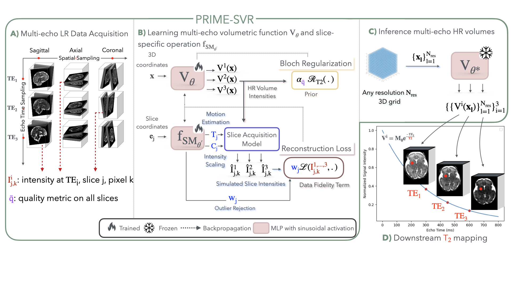

# PRIME-SVR
Physics-infoRmed Implicit Multi-Echo Slice-to-Volume Reconstruction for Fetal T2 mapping
[](https://arxiv.org/abs/2508.10680)

## Overview
**PRIME-SVR** is the first implicit neural representation (INR) framework for **joint multi-echo slice to volume reconstruction from motion corrupted 2D slice stacks of fetal MRI**. The method is **fully self-supervised**, trained for each subject: no ground-truth HR volume, no T2 values, no external motion estimation network are required.

## Method

- A **single fully connected network ($V_\theta$, a SIREN)** learns a continuous function shared across all TEs, mapping spatial coordinates directly to signal intensities at every echo time. Because this function is common to all TEs, information about the underlying anatomy is naturally shared and reinforced across echoes rather than being reconstructed independently for each one.
- A **second network ($f_{SM_\theta}$, a SIREN)** estimates slice-specific acquisition degradations (rigid motion, intensity scaling, outlier weighting) directly from the slice coordinates.
- **Cross-TE coherence is enforced through a Bloch-equation-derived regularization** that penalizes deviations from the expected mono-exponential T2 decay, with an adaptive weighting **$\alpha$** that strengthens the coupling for degraded stacks and relaxes it for high-quality acquisitions.

## Installation

1. **Clone the repository:**
```bash
git clone https://github.com/Medical-Image-Analysis-Laboratory/PRIME-SVR.git
cd PRIME-SVR
```

2. **Create the conda environment** using the provided full requirements file:
```bash
conda create -n prime-svr python=3.11.4
conda activate prime-svr
pip install -r requirements_full.txt
```

3. *(Optional, only for `--svort`)* [Docker](https://docs.docker.com/engine/install/) with GPU support. SVoRT runs in the `junshenxu/nesvor:v0.5.0` image, which is pulled on the first run.

## Data preparation
PRIME-SVR expects, per subject:
- At least one orthogonal stack at at least 3 different TEs, or any number of stacks acquired at different TEs (more than 3 TEs is also supported),
- Brain masks for each stack,
- Echo times (in ms),
- Average quality metric score $$\bar{q}$$ computed with [FetMRQC](https://hub.docker.com/r/thsanchez/fetmrqc) (optional, for optimal regularization strength **$\alpha$**).

## Quick start: the whole pipeline in one command

`prime_svr_pipeline.py` goes from a folder of T2w stacks and a folder of brain masks to the final reconstructions:

1. pairs every stack with its mask by file name,
2. denoises the stacks (ANTs non-local means), extracts the brain and dilates the masks,
3. *(optional, `--svort`)* runs SVoRT motion correction to register the slices in the standard space; PRIME-SVR then starts from the SVoRT slice positions, 
4. runs PRIME-SVR (one output channel per TE),
5. computes a brain mask of the reconstruction and returns the masked reconstruction with the intensities of the input stacks, in the space of the input stacks.

```bash
# multi-echo (T2 mapping): one output per TE, with the Bloch regularization
# Reconstructed volumes will not be in the standard space, PRIME-SVR correct the relative motion between stacks. For standard space reconstruction, you need either to run with svort initialisation or 
python prime_svr_pipeline.py --stacks /data/sub-01/anat --masks /data/sub-01/masks --output /data/out/sub-01 \
    --TEs 308 396 598 --coeff 1

# same, with SVoRT motion correction first, so PRIME-SVR reconstructions will be in the standard space
python prime_svr_pipeline.py --stacks ... --masks ... --output ... --TEs 308 396 598 --coeff 1 --svort

# single contrast: all stacks are reconstructed into one volume
python prime_svr_pipeline.py --stacks /data/sub-01/anat --masks /data/sub-01/masks --output /data/out/sub-01
```

### Inputs

| Argument | What to give |
|---|---|
| `--stacks` | A folder of T2w stacks (`.nii` / `.nii.gz`), or a list of stack files. |
| `--masks` | A folder of **undilated** brain masks, one per stack (or a list of files). The pipeline dilates them (`--dilate-iter`, default 4). |
| `--output` | The output folder. |
| `--TEs` | *(multi-echo)* The echo times in ms, one output channel per TE. Each stack is assigned to the closest TE (within 15%), read from the `EchoTime` of its JSON sidecar or `TE=` in the NIfTI header description. Stacks with another TE are skipped. |

- **Mask names.** A mask belongs to a stack when both names are equal once the words describing the kind of file are removed (`T2w`, `mask`, `desc-brain`, `dilated`, ...). For example, `sub-01_run-1_T2w.nii.gz` matches `sub-01_run-1_mask.nii.gz` or `sub-01_run-1_desc-brain_mask.nii.gz`. A stack without a mask is skipped with a warning.
- **Slice thickness.** Read from the `SliceThickness` of the JSON sidecar (`<stack>.json`), else the slice spacing of the NIfTI header. Use `--thickness` to force it.

### Outputs

All files are written to `--output`:

| File | Content |
|---|---|
| `<sub>_recon_echo-<n>.nii.gz` (`<sub>_recon.nii.gz` without `--TEs`) | Reconstruction of the n-th TE of `--TEs` (e.g. `sub-01_recon_echo-1.nii.gz` for 308 ms), brain masked, with the intensities of the input stacks |
| `<sub>_recon_mask.nii.gz` | Brain mask of the reconstruction (input slice masks moved with the learned motion, majority vote of the slices) |
| `config.yaml` | PRIME-SVR configuration of the run |
| `before_postprocessing/` | Raw PRIME-SVR outputs and the trained model (needed by `primesvr_to_reference.py`): deleted at the end of the run, unless `--keep-before-postprocessing` |
| `preprocessed/`, `svort/` | Preprocessed stacks and SVoRT slices: deleted at the end of the run, unless `--keep-intermediate` |

`<sub>` is the subject name taken from the first stack's file name (e.g. `sub-01`).

The reconstructions are in the scanner space of the input stacks, or in the SVoRT atlas space with `--svort`. All TEs share the same grid, so they can be fitted voxel-wise for T2 mapping directly.

### Main options

| Option | Default | Effect |
|---|---|---|
| `--coeff` | 0 | Bloch regularization weight $\alpha$ (needs `--TEs`), see [Choosing α](#choosing-α) |
| `--epochs` | 60 | Number of training epochs |
| `--spacing` | 0.8 | Isotropic voxel size of the reconstruction (mm) |
| `--svort` | off | SVoRT motion correction before PRIME-SVR |
| `--no-motion-correction` | off | Disables PRIME-SVR's slice motion correction: the slices stay where they are (scanner position, or SVoRT position with `--svort`). Slice scaling and outlier rejection are kept. |
| `--no-denoise` | off | Skips the denoising (for stacks that are already denoised) |
| `--sr-model` | `siren` | `multi_siren`: one independent network per TE (coupling across TEs then relies only on the Bloch regularization) |
| `--mask-threshold` | 0.5 | Fraction of slices that must vote "brain" for a voxel to be in `<sub>_recon_mask.nii.gz` |
| `--mask-dilate` | 3 | Dilation of the final mask in voxels, to avoid cropping the brain (`0` to disable) |
| `--reference` | none | Reference volume (e.g. a fetal atlas): the reconstruction is also given in its space and on its grid, see [Reconstruction in a reference space](#reconstruction-in-a-reference-space) |
| `--reference-init` | none | Initial ITK transform for the registration on `--reference` (`.txt` / `.mat`, e.g. from ITK-SNAP) |
| `--reference-name` | `atlas` | Name of the reference space in the output names |
| `--gpu` | 0 | GPU index |
| `--overwrite` | off | Recomputes every step |
| `--keep-intermediate` | off | Keeps `preprocessed/` and `svort/` (deleted at the end by default) |
| `--keep-before-postprocessing` | off | Keeps `before_postprocessing/` (deleted at the end by default), needed to run `primesvr_to_reference.py` afterwards or to reuse the training |

By default, existing outputs are reused when you run again in the same `--output` folder. The training is only reused if the configuration is exactly the same. Since `preprocessed/`, `svort/` and `before_postprocessing/` are deleted at the end, a new run recomputes them; use `--keep-intermediate` and `--keep-before-postprocessing` to avoid that when you plan several runs.

### Reconstruction in a reference space

With `--reference`, the reconstruction is also given in the space and on the grid of a reference volume, e.g. a fetal atlas of the right gestational age:

```bash
python prime_svr_pipeline.py --stacks ... --masks ... --output ... --TEs 308 396 598 --coeff 1 \
    --reference /atlas/STA30.nii.gz --reference-init /data/sub-01/recon_to_STA30.txt
```

1. The first echo (masked) is registered rigidly on the reference (ANTs, Mattes mutual information).
2. Every voxel of the reference grid is mapped to the PRIME-SVR grid with this transform.
3. The trained PRIME-SVR network is evaluated directly at those points, for every echo. The reconstruction is not resampled (no second interpolation), and all echoes use the same transform.

The reference should be brain extracted. When the orientation of the reconstruction is far from the reference (e.g. scanner space vs atlas space), the rigid registration needs an initial transform (`--reference-init`), e.g. a rough manual alignment saved from ITK-SNAP. Its direction (as is, or inverted) is detected automatically.

Additional outputs, in `--output`:

| File | Content |
|---|---|
| `<sub>_recon_echo-<n>_space-<name>.nii.gz` | Reconstruction on the reference grid, brain masked, with the intensities of the input stacks |
| `<sub>_recon_mask_space-<name>.nii.gz` | Brain mask on the reference grid |
| `space-<name>/` | ANTs transforms (`primesvr_to_<name>_0GenericAffine.mat`) |

Check the registration by overlaying `<sub>_recon_echo-1_space-<name>.nii.gz` on the reference.

The same step can be run on its own on a finished run (from the pipeline with `--keep-before-postprocessing`, or from `run_prime_svr.py`), without training again:

```bash
python primesvr_to_reference.py <output>/config.yaml /atlas/STA30.nii.gz --name STA30 \
    --init recon_to_STA30.txt --mask <output>/<sub>_recon_mask.nii.gz
```

Here the registered volume is `<recon_dir>/<sub>_recon_0.nii.gz` (`--channel` to change it), so a manual `--init` transform must be made from that file. The outputs `<sub>_recon_echo-<n>_space-<name>.nii.gz`, the mask (with `--mask`) and the transform are written to `<recon_dir>/space-<name>/` (`--out-dir` to change it).

### Changing the hyperparameters

Any other configuration key can be set with `--set key=value` (repeatable). Keys of the `data:` section take a `data.` prefix; values are read as YAML.

```bash
python prime_svr_pipeline.py --stacks ... --masks ... --output ... --TEs 308 396 598 --coeff 1 \
    --set batch_size=20000 --set lr_sr=1e-4 --set sr_n_hidden_layers=5 \
    --set "data.recon_spacing=[0.5,0.5,0.5]"
```

The available keys and their defaults are in `default_config()` of `prime_svr_pipeline.py`, and the configuration actually used is saved to `<output>/config.yaml`. A misspelled key stops the run with an error.

## Choosing α

The regularization coefficient **$\alpha$** (`--coeff` in the pipeline, `coeff` in the config file) can be left at its default value, or set optimally based on the quality score using the following rule:

$$
\alpha(\bar{q}) =
\begin{cases}
[10, 30], & \text{if } \bar{q} < 0.9 \text{ or fewer than 3 stacks/TEs}, \\
\ ]0, 1], & \text{if } \bar{q} \ge 0.9.
\end{cases}
$$

## Running from a config file

Reconstruction can also be driven by a single YAML configuration file, passed to the main training/reconstruction script `run_prime_svr.py`. This runs PRIME-SVR only: the preprocessing and the post-processing of the one-command pipeline are not applied.

**1. Prepare the data.** Each stack should already be denoised, bias field corrected and brain extracted, and each mask dilated (the one-command pipeline uses 4 dilation iterations).

**2. Copy the template config and fill it in with your data:**
```bash
cp configs/config_model.yaml configs/config_sub-01.yaml
```

The fields to fill in are:

| Key | What to put |
|---|---|
| `data.path_stacks` | Paths of all stacks, of all TEs. The first stack is the reference stack. |
| `data.path_masks` | Paths of the (dilated) masks, in the same order as `path_stacks` |
| `data.slice_thickness` | Slice thickness of each stack, in mm, in the same order |
| `data.output_channel` | For each stack, the index of its TE in `data.echotime`, starting at `0` |
| `data.echotime` | The echo times, in ms |
| `data.recon_dir` | The output folder |
| `data.coeff` | Bloch regularization weight $\alpha$ (`0` to disable it), see [Choosing α](#choosing-α) |
| `sr_out_dim` | The number of TEs (length of `data.echotime`) |

All the other keys are hyperparameters and can be left at their default values (see [Changing the hyperparameters](#changing-the-hyperparameters) for the main ones).

**3. Run PRIME-SVR:**
```bash
python run_prime_svr.py --config configs/config_sub-01.yaml
```

A few hyperparameters can also be overridden on the command line without editing the config: `--epochs`, `--batch_size`, `--psf_card_end`, `--sr_omega_0`, `--sr_n_hidden_layers`, `--sr_n_units` and `--sr_loss_metric`, e.g.
```bash
python run_prime_svr.py --config configs/config_sub-01.yaml --epochs 300
```

**Outputs** (in `data.recon_dir`, `<sub>` is taken from the first stack's file name):

| File | Content |
|---|---|
| `<sub>_recon_<c>.nii.gz` | Reconstruction of output channel `c` (the TE `data.echotime[c]`), not masked |
| `mc.npy` | Learned motion of every slice |
| `min_max_values.npy` | Intensity range of the input stacks |
| `loss.npy` | Loss history |
| `svr_model.pth` | Trained model |

## Acknowledgments
This repository builds upon the implicit neural representation SIREN-based slice-to-volume reconstruction frameworks developed by **Maik Dannecker** and **Steven Jia** for multi-contrast (T1w/T2w) fetal MRI reconstruction. We acknowledge their foundational work, which this project extends to the joint multi-echo, physics-informed SVR for T2 mapping setting.

## Citation
If you use PRIME-SVR in your research, please cite:
```bibtex
@article{bulut2025primesvr,
  title   = {Physics-Informed Joint Multi-TE Super-Resolution with Implicit Neural Representation for Robust Fetal T2 Mapping},
  author  = {Bulut, Busra and Dannecker, Maik and Sanchez, Thomas and Neves Silva, Sara and Jia, Steven and Ledoux, Jean-Baptiste and Pomar, Leo and Sichitiu, Joanna and Gomez, Yvan and Koob, Meriam and Dunet, Vincent and Deprez, Maria and Auzias, Guillaume and Rousseau, Fran\c{c}ois and Hutter, Jana and Rueckert, Daniel and Bach Cuadra, Meritxell},
  journal = {arXiv preprint arXiv:2508.10680},
  year    = {2026}
}
```

## Contact
For questions, please open an issue or contact **Busra Bulut** — busra.bulut@unil.ch — Department of Radiology, Lausanne University Hospital and University of Lausanne.
